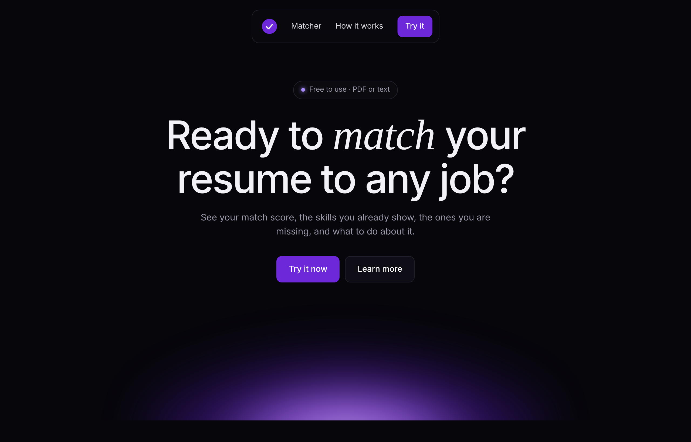
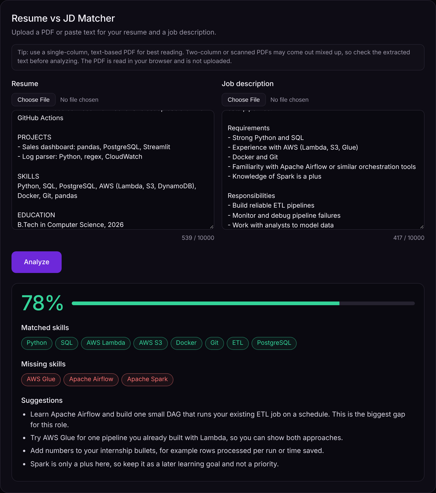
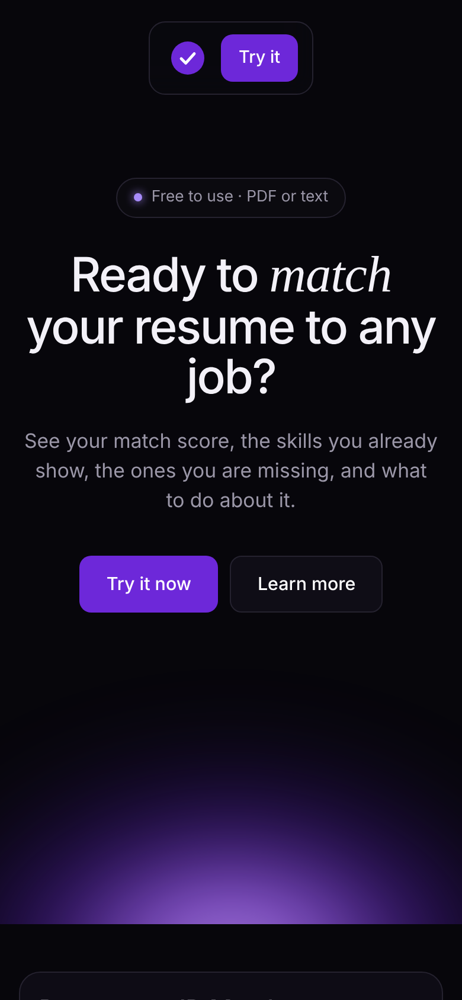
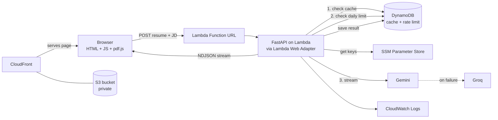

<div align="center">

# Resume vs JD Matcher

**Paste or upload your resume and a job description. Get a match score, the skills you already show, the ones you are missing, and what to do about it.**

*Serverless, AWS only, with live streaming results.*

**Live demo: https://dp2hedo686otb.cloudfront.net**

<br>


<br>



</div>

<br>

## What it does

You give it a resume and a job description. It reads both and tells you:

- a **match score** from 0 to 100
- **matched skills**: what the JD asks for and your resume clearly shows
- **missing skills**: what the JD asks for and your resume does not show
- **3 to 5 suggestions** that are specific to your resume and that JD

The result is streamed to the page as the model writes it, and the score bar animates up to the final number.

<div align="center">

</div>

## Features

- **PDF or paste.** Upload a PDF for the resume and the JD, or paste the text. PDF text is extracted in your browser with pdf.js, so the file itself is never uploaded.
- **Real streaming.** The backend streams the model output to the browser as newline-delimited JSON, so you see the result build up instead of waiting for a spinner.
- **Two LLM providers.** Gemini is the main model. If it fails or hits a limit, the request moves to Groq automatically. Each provider gets two tries (only for 429, 5xx and network errors) before moving on.
- **Structured output.** The model is asked for JSON that follows a fixed schema, and the backend cleans and clamps the result again before sending it (score 0 to 100, capped list sizes, trimmed strings).
- **Cache.** The same resume and JD pair is answered from DynamoDB instead of calling the LLM again. Cache entries expire after 7 days.
- **Rate limit.** 20 analyses per IP per day, tracked in DynamoDB with TTL so old records delete themselves. The IP is hashed before it is stored.
- **Prompt injection guard.** The resume and JD are sent between markers and the system prompt tells the model to treat them only as data.
- **Input limits.** 10,000 characters per field and 3 MB / 5 pages per PDF in the UI, with a 20,000 character hard limit on the backend.
- **Mobile friendly.** Works on phone and laptop.

<div align="center">

</div>

## Architecture



**Request flow**

1. The browser loads the page from CloudFront (files come from a private S3 bucket). It sends the resume and JD text to the Lambda Function URL.
2. The backend validates the input and hashes `resume + JD`. If the hash is in the cache, it returns the saved result straight away.
3. If not, it checks the per-IP daily limit.
4. It streams the answer from Gemini (falls back to Groq if needed) and forwards each piece to the browser.
5. The final result is cleaned, saved to the cache and sent as the last event.

## Tech stack

| Part | Choice |
|---|---|
| Frontend | Plain HTML, CSS and JavaScript, pdf.js for PDF text |
| Backend | Python, FastAPI, Uvicorn on AWS Lambda with Lambda Web Adapter |
| Endpoint | Lambda Function URL |
| Database | DynamoDB (cache and rate limits, with TTL) |
| Secrets | SSM Parameter Store (SecureString) |
| LLMs | Gemini `gemini-3.5-flash-lite`, fallback Groq `openai/gpt-oss-120b` |
| Infra as code | AWS SAM |
| Monitoring | CloudWatch Logs, AWS Budget alert |
| Hosting | S3 (private) + CloudFront with Origin Access Control |

## Privacy

- Resume and JD text are **not stored** and are **not logged**.
- DynamoDB keeps only a SHA-256 hash of the input and the analysis result (score, skills, suggestions) for 7 days, so repeat requests are fast.
- For the rate limit, the IP address is hashed and kept for about 2 days.
- Text is sent to the LLM providers (Gemini, or Groq on fallback) to produce the analysis.

## Project structure

```
.
├── src/
│   ├── app.py            # FastAPI app: validation, cache, rate limit, streaming
│   ├── llm.py            # Gemini + Groq streaming, retry and fallback
│   ├── prompt.py         # System prompt and JSON response schema
│   ├── validate.py       # Cleans and clamps the model output
│   ├── store.py          # DynamoDB cache and per-IP daily limit
│   ├── run.sh            # Starts Uvicorn for Lambda Web Adapter
│   └── requirements.txt
├── frontend/
│   ├── index.html        # Page, PDF reading, stream rendering
│   └── config.js         # Sets API_URL (gitignored, made by deploy_frontend.sh)
├── images/               # Screenshots
├── template.yaml         # SAM template (Lambda, DynamoDB, S3, CloudFront)
├── deploy_frontend.sh    # Uploads frontend to S3 and clears CloudFront cache
└── README.md
```

## Run it yourself

**Prerequisites:** an AWS account, AWS CLI and SAM CLI installed and configured, a Gemini API key and a Groq API key.

**1. Store the keys in SSM**

```bash
aws ssm put-parameter --name /resume-matcher/gemini-api-key --type SecureString --value "YOUR_GEMINI_KEY"
aws ssm put-parameter --name /resume-matcher/groq-key --type SecureString --value "YOUR_GROQ_KEY"
```

**2. Build and deploy the stack**

```bash
sam build
sam deploy --guided
```

This creates the Lambda function, DynamoDB table, S3 bucket and CloudFront distribution. CORS on the Function URL allows only the CloudFront domain and `http://localhost:8000`.

**3. Upload the frontend**

```bash
chmod +x deploy_frontend.sh
./deploy_frontend.sh
```

This writes `frontend/config.js` from the stack output, syncs `frontend/` to S3 and clears the CloudFront cache. It prints the site URL at the end.

**4. (Optional) Run the page locally**

Create `frontend/config.js` with your Function URL (the script above does this too), then:

```bash
cd frontend
python3 -m http.server 8000
```

Open `http://localhost:8000` (use `localhost`, not `0.0.0.0`, so it matches the CORS rule).

## Status

- Backend on AWS Lambda, with Gemini, Groq fallback, cache and rate limit: **done**
- Streaming result and animated score: **done**
- PDF upload for resume and JD: **done**
- Hosting the website on S3 + CloudFront: **done**

## Ideas for later

- Login and saved history
- Rewrite resume bullets for a specific JD
- OCR for scanned PDFs

## Author

Built by [Sarang](https://github.com/sarangKP).